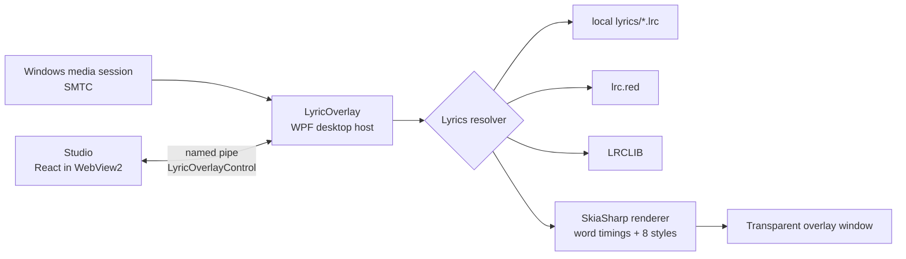

<div align="center">
  
  <h1 align="center">LyricsOverlay</h1>
  <p><em>Karaoke-style synced lyrics, floating above anything you do on Windows.</em></p>

  <p>
    
    
    
    
    
    
  </p>
</div>

---

LyricsOverlay watches the song playing in your system media session, finds time-synced lyrics, and renders them in a transparent, always-on-top window. Pick from eight animated styles, tune everything live from the built-in studio, and keep singing along — in games, in videos, or in a full-screen karaoke view.

> **No account, no subscription, no player plugin.** If Windows shows the track in its media session, LyricsOverlay can follow it.

## Table of contents

- [✨ Features](#-features)
- [🎨 Lyric styles](#-lyric-styles)
- [🧩 How it works](#-how-it-works)
- [🚀 Getting started](#-getting-started)
- [🎛️ Using LyricsOverlay](#️-using-lyricsoverlay)
- [📁 Project structure](#-project-structure)
- [🧪 Diagnostics](#-diagnostics)
- [🤝 Contributing](#-contributing)
- [📄 License & credits](#-license--credits)

## ✨ Features

| | Feature | What it does |
|:--:|---|---|
| 🎵 | **Automatic track detection** | Reads the Windows system media session (SMTC) — Spotify, Apple Music, browsers and more — with drift-corrected timing. |
| 📝 | **Smart lyric lookup** | lrc.red by default, LRCLIB as an automatic fallback, and a local `lyrics/Artist - Title.lrc` file that always wins. Results are cached per track. |
| 🎤 | **Word-level sync** | Per-word timings drive karaoke fills, growing vines, typing cursors and flaring stars. |
| 🎨 | **Eight visual styles** | From minimal centred kinetic text to a full-screen scattered lyric field. |
| 🖥️ | **Studio control panel** | A React app embedded through WebView2: size, font, screen and aesthetics, updated live. |
| 🖼️ | **Artwork-matched colors** | Optional palette extraction from album art, with manual color overrides when you want control. |
| ⏱️ | **Fine tuning** | Sync offset in milliseconds, text scale, full-screen mode, keep-awake, auto-start. |
| 🛠️ | **Ships as one installer** | Self-contained .NET publish plus an NSIS setup — no .NET runtime needed on the target PC. |

## 🎨 Lyric styles

Each style has its own stage ambience and accent color in the studio gallery.

| Style | Preview color | Description |
|---|:---:|---|
| Kinetic |  | Words fill one at a time, centred. |
| Fisheye |  | A tight stack bulging through a lens. |
| Code Style |  | Three lines of source; the newest lyric types out under a red cursor. |
| Vine |  | A wavy vine with a glowing tip; tendrils grow as the tip reaches each word. |
| Constellation |  | Words as stars in a loose sky, drawn in time; the sung star flares. |
| Bubble |  | Recent lines as chat bubbles. |
| Native Design |  | The song as a chat thread; the newest bubble reveals as it is sung. |
| Kinetic Scatter |  | Full-screen only: words scatter across the stage, each landing in its own zone. |

## 🧩 How it works



The desktop app listens to `GlobalSystemMediaTransportControlsSessionManager`, resolves lyrics (local file first, then both online providers in parallel), and paints them with SkiaSharp onto a transparent WPF window. The studio is a Vite/React bundle served inside WebView2; it reads and patches live state over `\\.\pipe\LyricOverlayControl`. In a plain browser the bridge is a no-op, so you can safely preview the UI without the desktop app running.

## 🚀 Getting started

### Install

1. Download the latest `LyricsOverlay-Setup-<version>.exe` from [Releases](https://github.com/sidpi/LyricsOverlay/releases).
2. Run the installer and start **LyricsOverlay** from the Start menu.
3. Play a song in any app that publishes a Windows media session — lyrics appear automatically.
4. Double-click the tray icon to open the studio and make it yours.

### Build from source

Requirements:

- **Windows 10 1809+** (build 17763) or Windows 11
- [.NET 10 SDK](https://dotnet.microsoft.com/download)
- [Node.js](https://nodejs.org/) 20.19+ or 22.12+
- [WebView2 Runtime](https://developer.microsoft.com/microsoft-edge/webview2/) (pre-installed on Windows 11)
- [NSIS 3](https://nsis.sourceforge.io/Download) on your `PATH`, or set `NSIS_MAKENSIS` to your `makensis.exe`

```powershell
git clone https://github.com/sidpi/LyricsOverlay.git
cd LyricsOverlay/LyricsOverlay
npm install

# Preview just the studio in a browser (bridge calls are no-ops)
npm run dev

# Type-check and bundle the studio into ../LyricOverlay/Studio
npm run build

# Studio + self-contained publish + NSIS installer -> ../dist/LyricsOverlay-Setup-<version>.exe
npm run dist
```

To run the desktop host directly after building the studio:

```powershell
dotnet run --project LyricOverlay/LyricOverlay.csproj
```

The version is declared once, in `LyricOverlay/LyricOverlay.csproj`; the installer filename, metadata and studio manifest are all generated from it.

## 🎛️ Using LyricsOverlay

**Studio tabs**

| Tab | Controls |
|---|---|
| **Size** | Text scale and overlay sizing. |
| **Font** | Choose from system fonts such as SF Pro Display, Segoe UI, Bahnschrift, Georgia, Consolas, Cascadia Mono. |
| **Screen** | Full-screen mode, hidden state, display targeting. |
| **Aesthetics** | Text / highlight / secondary colors, album-art color matching, lyric provider, sync offset, keep-awake, auto-start. |

**System tray** — right-click for quick actions: show/hide lyrics, pause, open the studio, quit. Double-click opens the studio. "Kinetic Scatter" is only offered while full-screen lyrics are enabled.

**Hand-timed lyrics** — drop a file named `Artist - Title.lrc` into a `lyrics/` folder next to the executable (or the working directory). It overrides both online providers.

## 📁 Project structure

```text
verci/
├── LyricOverlay/               # C# / WPF desktop host
│   ├── Lyrics/                 # LRC parsing, timing, lrc.red + LRCLIB providers
│   ├── Rendering/              # SkiaSharp renderers, styles, fonts, layout
│   ├── Services/               # Media session, named-pipe control, auto-start, tray helpers
│   ├── Studio/                 # Built studio bundle served by WebView2 (generated)
│   ├── Tray/                   # System-tray icon and menu
│   ├── installer/              # NSIS setup script
│   └── tools/                  # Helper scripts (logo conversion, pipe test)
├── LyricsOverlay/              # React + TypeScript studio source
│   └── src/
│       ├── components/         # Top bar, hero stage, style gallery, inspector
│       ├── engines/            # Previews for each lyric style
│       ├── lib/                # WebView2 bridge, clock, colors, styles
│       ├── routes/             # Dashboard
│       └── store/              # Zustand state shared with the overlay
└── dist/                       # Installer output
```

## 🧪 Diagnostics

Check the whole pipeline without opening a window:

```powershell
LyricOverlay.exe --self-test
```

It prints the current media session, resolved track, chosen lyrics provider, line count, artwork palette and the current/next lyric line.

```powershell
LyricOverlay.exe --tray        # start in the tray (used by auto-start)
LyricOverlay.exe --render ...  # headless renderer, used by the studio previews
```

Logs are written by the diagnostics module; control requests and renderer failures are recorded there too.

## 🤝 Contributing

Issues and pull requests are welcome at [sidpi/LyricsOverlay](https://github.com/sidpi/LyricsOverlay). If you are changing the studio, run `npm run build` so the C# project picks up the new bundle; if you are changing the overlay, `npm run dist` is the end-to-end verification.

## 📄 License & credits

Released under the [MIT License](LICENSE) — see [LICENSE](LICENSE) for the full text.

Lyrics data comes from [lrc.red](https://lrc.red/) and [LRCLIB](https://lrclib.net/); the installer is built with [NSIS](https://nsis.sourceforge.io/). Thanks to those projects for making synced lyrics easy to find.
