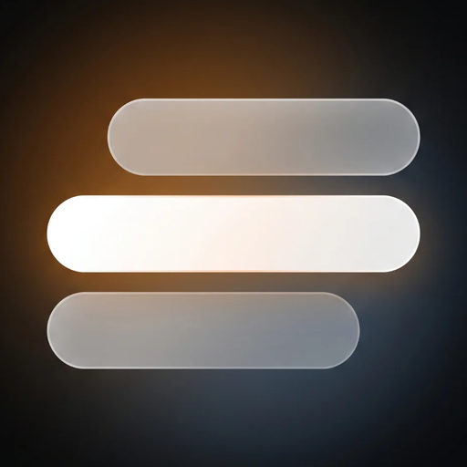
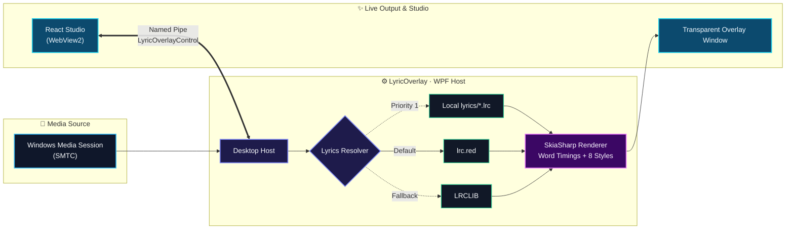

<div align="center">
  

  <br />

  

  <h1>LyricsOverlay</h1>

  <a href="https://github.com/sidpi/LyricsOverlay">
    
  </a>

  <p>
    <a href="https://github.com/sidpi/LyricsOverlay/releases">
      
    </a>
    
    
    
    <a href="LICENSE">
      
    </a>
    <a href="https://github.com/sidpi/LyricsOverlay/stargazers">
      
    </a>
  </p>

  <br />

  <p>
    <a href="https://github.com/sidpi/LyricsOverlay/releases/latest">
      
    </a>
    &nbsp;
    <a href="#-lyric-styles">
      
    </a>
    &nbsp;
    <a href="#-build-from-source">
      
    </a>
  </p>

  <br />

  <p>
    <a href="#-features">Features</a> &nbsp;✦&nbsp;
    <a href="#-lyric-styles">Styles</a> &nbsp;✦&nbsp;
    <a href="#-quick-start">Quick Start</a> &nbsp;✦&nbsp;
    <a href="#-how-it-works">Architecture</a> &nbsp;✦&nbsp;
    <a href="#-studio-controls">Studio</a> &nbsp;✦&nbsp;
    <a href="#-diagnostics">Diagnostics</a>
  </p>
</div>

<!-- Showcase Slot: Add a GIF or screenshot of the overlay & studio here for maximum impact
<br />
<div align="center">
  
</div>
-->

<br />

<div align="center">
  <p>
    <strong>LyricsOverlay</strong> watches the song playing in your Windows media session, fetches time-synced lyrics, and renders them in a transparent, always-on-top window.<br />
    Switch between eight animated styles, dial in every detail live from the built-in studio, and sing along — over games, videos, or a full-screen karaoke stage.
  </p>
</div>

> [!TIP]
> **Zero setup per player.** If Windows displays the track in its system media session (Spotify, Apple Music, browsers, and more), LyricsOverlay follows it automatically.

---

## ✨ Features

<table>
  <tr>
    <td width="50%" valign="top">
      <h3>🎵 Automatic Track Detection</h3>
      Reads the Windows System Media Transport Controls (<code>SMTC</code>) with drift-corrected playback timing across Spotify, Apple Music, browsers, and more.
    </td>
    <td width="50%" valign="top">
      <h3>📝 Smart Multi-Source Lookup</h3>
      Queries <code>lrc.red</code> by default with automatic <code>LRCLIB</code> fallback — while local <code>lyrics/Artist - Title.lrc</code> files always win. Cached per track.
    </td>
  </tr>
  <tr>
    <td width="50%" valign="top">
      <h3>🎤 True Word-Level Sync</h3>
      Per-word timestamps drive liquid karaoke fills, sprouting vines, live typing cursors, and flaring star constellations.
    </td>
    <td width="50%" valign="top">
      <h3>🎨 Eight Animated Styles</h3>
      Jump from clean centered kinetic text to chat-style lyric threads or a full-screen scattered stage.
    </td>
  </tr>
  <tr>
    <td width="50%" valign="top">
      <h3>🖥️ Embedded Studio Panel</h3>
      A live React app hosted inside <code>WebView2</code> lets you tune size, typography, display targeting, and aesthetics with instant feedback.
    </td>
    <td width="50%" valign="top">
      <h3>🖼️ Artwork-Matched Palettes</h3>
      Extracts dynamic accent colors directly from the current album cover, with full manual color overrides whenever you want them.
    </td>
  </tr>
  <tr>
    <td width="50%" valign="top">
      <h3>⏱️ Precision Controls</h3>
      Adjust millisecond sync offset, text scale, full-screen karaoke view, keep-awake, and Windows auto-start.
    </td>
    <td width="50%" valign="top">
      <h3>📦 One-Click Self-Contained Setup</h3>
      Distributed as a self-contained <code>.NET 10</code> publish packaged with <code>NSIS</code> — no runtime installation required.
    </td>
  </tr>
</table>

---

## 🎨 Lyric Styles

Each preset brings its own stage ambience and signature accent inside the studio gallery.

<table>
  <tr>
    <td width="50%" valign="top">
      &nbsp;<kbd>Any Mode</kbd><br /><br />
      Words fill smoothly one at a time, balanced and centered on screen.
    </td>
    <td width="50%" valign="top">
      &nbsp;<kbd>Any Mode</kbd><br /><br />
      A tight lyric stack bulging outward through an optical lens curve.
    </td>
  </tr>
  <tr>
    <td width="50%" valign="top">
      &nbsp;<kbd>Any Mode</kbd><br /><br />
      A shell transcript: the last line sits above as a muted `//` comment, the current line fills in after a red `>` prompt.
    </td>
    <td width="50%" valign="top">
      &nbsp;<kbd>Any Mode</kbd><br /><br />
      A wavy vine with a glowing tip whose tendrils sprout as each word is reached.
    </td>
  </tr>
  <tr>
    <td width="50%" valign="top">
      &nbsp;<kbd>Any Mode</kbd><br /><br />
      Words chart out like stars across a loose sky; the active sung star flares bright.
    </td>
    <td width="50%" valign="top">
      &nbsp;<kbd>Any Mode</kbd><br /><br />
      Recent lyric lines float into view as clean, minimal chat bubbles.
    </td>
  </tr>
  <tr>
    <td width="50%" valign="top">
      &nbsp;<kbd>Any Mode</kbd><br /><br />
      The track plays out like an active chat thread, revealing the latest bubble as it is sung.
    </td>
    <td width="50%" valign="top">
      &nbsp;<kbd>Full-Screen Only</kbd><br /><br />
      Words scatter dramatically across the full stage, each landing in its own zone.
    </td>
  </tr>
</table>

---

## 🚀 Quick Start

<table>
  <tr>
    <td width="25%" align="center" valign="top">
      <h3>01 · Download</h3>
      Grab the latest <code>LyricsOverlay-Setup-&lt;version&gt;.exe</code> from <a href="https://github.com/sidpi/LyricsOverlay/releases">Releases</a>.
    </td>
    <td width="25%" align="center" valign="top">
      <h3>02 · Install</h3>
      Run the installer and launch <strong>LyricsOverlay</strong> straight from the Start menu.
    </td>
    <td width="25%" align="center" valign="top">
      <h3>03 · Hit Play</h3>
      Start any track in an app that uses the Windows media session — lyrics appear live.
    </td>
    <td width="25%" align="center" valign="top">
      <h3>04 · Make It Yours</h3>
      <kbd>Double-click</kbd> the tray icon anytime to open the Studio and dial in your look.
    </td>
  </tr>
</table>

---

## 🧩 How It Works



The desktop host listens to `GlobalSystemMediaTransportControlsSessionManager`, resolves lyrics (local `.lrc` first, then both online providers in parallel), and renders smooth frames via **SkiaSharp** onto a transparent WPF window.

The **Studio** is a Vite + React bundle inside WebView2 that reads and patches live state over `\\.\pipe\LyricOverlayControl`. When opened in a standard browser, the bridge safely becomes a no-op so you can preview and develop the UI standalone.

The studio previews are DOM/CSS re-creations that loop a demo track at 60 fps, while the overlay paints the live track with Skia at 30 fps. They are tuned to look the same, not pixel-identical: treat a preview as a close approximation of the style, not a frame-accurate mirror.

---

## 🎛️ Studio Controls

| Tab | What You Can Customize |
|---|---|
| <kbd>Size</kbd> | Global text scale and overlay window sizing. |
| <kbd>Font</kbd> | System typefaces including **SF Pro Display**, **Segoe UI**, **Bahnschrift**, **Georgia**, **Consolas**, **Cascadia Mono**, and **Cascadia Code**. |
| <kbd>Screen</kbd> | Full-screen karaoke mode, hidden toggle, and multi-monitor display targeting. |
| <kbd>Aesthetics</kbd> | Text, highlight, and secondary colors; album-art palette matching; lyric provider; millisecond sync offset; keep-awake; and auto-start. |

> [!NOTE]
> - **System Tray:** <kbd>Double-click</kbd> to open the Studio, or <kbd>Right-click</kbd> to show/hide lyrics, pause, launch the Studio, or quit.
> - **Exclusive Style:** **Kinetic Scatter** unlocks automatically whenever full-screen lyrics mode is enabled.
> - **Custom Hand-Timed Lyrics:** Drop `Artist - Title.lrc` inside a `lyrics/` folder next to the executable (or in the working directory) to override all online providers.

---

## 🛠️ Build from Source

<details>
<summary><strong>▸ Click to expand prerequisites, build commands &amp; packaging</strong></summary>

<br />

### Requirements

| Dependency | Version / Notes |
|---|---|
| **OS** | Windows 10 1809+ (build 17763) or Windows 11 |
| **.NET SDK** | [.NET 10 SDK](https://dotnet.microsoft.com/download) |
| **Node.js** | [Node.js](https://nodejs.org/) `20.19+` or `22.12+` |
| **WebView2** | [WebView2 Runtime](https://developer.microsoft.com/microsoft-edge/webview2/) *(pre-installed on Windows 11)* |
| **Installer** | [NSIS 3](https://nsis.sourceforge.io/Download) on `PATH`, or `NSIS_MAKENSIS` pointing to `makensis.exe` |

### Commands

```powershell
git clone https://github.com/sidpi/LyricsOverlay.git
cd LyricsOverlay/LyricsOverlay
npm install

# Preview just the studio in a browser (bridge calls are no-ops)
npm run dev

# Type-check and bundle the studio into ../LyricOverlay/Studio
npm run build

# Studio + self-contained publish + NSIS installer -> ../dist/LyricsOverlay-Setup-<version>.exe
npm run dist
```

Run the desktop host directly after building the studio:

```powershell
dotnet run --project LyricOverlay/LyricOverlay.csproj
```

> [!IMPORTANT]
> The version is declared in a single source of truth: `LyricOverlay/LyricOverlay.csproj`. The installer filename, metadata, and studio manifest are all generated from it automatically.

</details>

<details>
<summary><strong>▸ Click to explore the project structure</strong></summary>

<br />

```text
verci/
├── LyricOverlay/               # C# / WPF desktop host
│   ├── Lyrics/                 # LRC parsing, timing, lrc.red + LRCLIB providers
│   ├── Rendering/              # SkiaSharp renderers, styles, fonts, layout
│   ├── Services/               # Media session, named-pipe control, auto-start, tray helpers
│   ├── Studio/                 # Built studio bundle served by WebView2 (generated)
│   ├── Tray/                   # System-tray icon and menu
│   ├── installer/              # NSIS setup script
│   └── tools/                  # Helper scripts (logo conversion, pipe test)
├── LyricsOverlay/              # React + TypeScript studio source
│   └── src/
│       ├── components/         # Top bar, hero stage, style gallery, inspector
│       ├── engines/            # Previews for each lyric style
│       ├── lib/                # WebView2 bridge, clock, colors, styles
│       ├── routes/             # Dashboard
│       └── store/              # Zustand state shared with the overlay
└── dist/                       # Installer output
```

</details>

---

## 🧪 Diagnostics

Inspect the entire media-to-lyrics pipeline headlessly without launching the overlay window:

```powershell
LyricOverlay.exe --self-test
```

Outputs the active media session, resolved track metadata, selected lyric provider, line count, extracted artwork palette, and the current/next lyric lines.

| CLI Flag | Behavior |
|---|---|
| <kbd>--self-test</kbd> | Runs full pipeline diagnostics directly in the terminal. |
| <kbd>--tray</kbd> | Starts minimized directly in the system tray (used by Windows auto-start). |
| <kbd>--render ...</kbd> | Launches the headless renderer used for studio style previews. |
| <kbd>--bench</kbd> | Paints every style headlessly and reports milliseconds and managed bytes per frame. |

Control requests and renderer failures are automatically logged by the diagnostics module.

---

## 🤝 Contributing

Issues and pull requests are always welcome at **[sidpi/LyricsOverlay](https://github.com/sidpi/LyricsOverlay)**.

- **Studio changes:** Run `npm run build` so the C# project picks up the freshly compiled bundle.
- **Overlay changes:** Run `npm run dist` for full end-to-end packaging verification.

---

<div align="center">
  <br />
  <p>
    Released under the <a href="LICENSE"><strong>MIT License</strong></a>
  </p>
  <p>
    Lyrics powered by <a href="https://lrc.red/">lrc.red</a> &amp; <a href="https://lrclib.net/">LRCLIB</a> &nbsp;·&nbsp; Packaged with <a href="https://nsis.sourceforge.io/">NSIS</a>
  </p>
  <p>
    <a href="#lyricsoverlay"><strong>↑ Back to Top</strong></a>
  </p>
  
</div>
